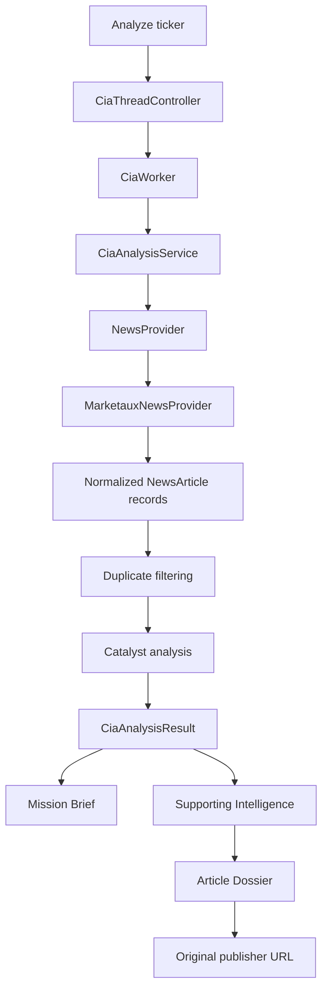

# C.I.A. — Catalyst Intelligence Analysis

[← Back to Main README](../README.md) · [Desktop GUI](gui.md)

C.I.A. examines ticker-specific financial news to identify potential catalysts, their recency, and the evidence behind a briefing. It is an intelligence aid, not a trading signal or guarantee of price movement.

## Current capabilities

- Retrieve ticker-specific news through the `NewsProvider` interface, currently backed by Marketaux in the desktop application.
- Normalize provider records into `NewsArticle` models and remove duplicate articles.
- Classify recognized catalysts, distinguish current from historical context, and evaluate freshness.
- Calculate aggregate sentiment, catalyst strength, and confidence.
- Return a `CiaAnalysisResult` containing both a `CatalystReport` and the deduplicated supporting articles.
- Present the report in the desktop Mission Brief, with an article table and navigable dossier.

## Analysis and presentation flow

The service and analysis logic do not depend on PySide6. The GUI starts analysis on a background `QThread` and receives the result through Qt signals.

## News provider

`MarketauxNewsProvider` requests English-language, ticker-specific news and maps the matching ticker entity's sentiment into normalized articles. The current implementation caps each request at **three articles**, even if the analysis service requests a higher limit.

Configure `STONKS_MARKETAUX_API_KEY` in the local `.env` file to use the desktop CIA workspace. Missing credentials, provider access limits, rate limits, malformed responses, and network errors are surfaced as failures rather than silently converted into an empty result. A successful request with no articles produces an empty briefing.

The dossier displays provider-supplied metadata and summary; it does **not** retrieve or reproduce the full publisher article.

## Freshness

| Age of newest recognized catalyst   | Classification |
| ----------------------------------- | -------------- |
| Up to 60 minutes                    | Breaking       |
| More than 60 minutes, up to 4 hours | Fresh          |
| More than 4 hours, up to 24 hours   | Recent         |
| More than 24 hours                  | Stale          |
| No usable catalyst timestamp        | Unknown        |

Recognized Breaking, Fresh, and Recent catalysts contribute to current intelligence; older recognized catalysts remain available as historical context. Thresholds are defined in `stonks/config/settings.py`.

## Recognized catalyst categories

C.I.A. currently recognizes:

- Contract / Purchase Order
- Acquisition
- Merger
- Earnings
- Revenue Growth
- Regulatory Approval
- Patent
- Institutional Investment
- Short Interest
- Reverse Stock Split
- Public Offering
- Bankruptcy / Restructuring
- Management Change
- Analyst Report
- Momentum / Hype

Articles without a recognized category are shown as **Unclassified** in the GUI.

## Report and evidence

| Model               | Responsibility                                                                                                                                     |
| ------------------- | -------------------------------------------------------------------------------------------------------------------------------------------------- |
| `NewsArticle`       | Headline, source, publication time, summary, URL, and sentiment                                                                                    |
| `CatalystReport`    | Ticker, catalyst strength, current/historical categories, sentiment, confidence, freshness, counts, breaking-news indicator, and narrative summary |
| `CiaAnalysisResult` | The report together with deduplicated articles used to support it                                                                                  |

The Mission Brief shows the ticker, mission status, strength, freshness, sentiment, confidence, article counts, current intelligence, historical context, and summary. Supporting Intelligence lists the articles used in the analysis. Selecting an article opens its dossier with source details and a button to open a valid HTTP(S) publisher URL in the system browser.

A later provider failure leaves the last successful briefing visible. The active request cannot be interrupted mid-provider call; closing the application waits until its worker finishes.
