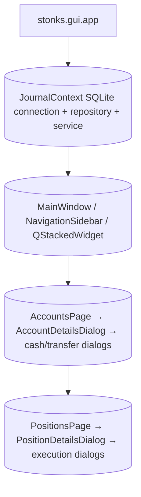

# STONKS Desktop GUI

[← Back to Main README](../README.md) · [Journal Subsystem](journal.md)

The PySide6 interface provides an account-aware Trading Journal with a reusable main window, sidebar, dark theme, and dialog-based editing. Financial rules and database writes stay in the Journal service layer.

## Launch

After setting up and activating the Windows development environment:

```powershell
.\scripts\init.ps1
.\scripts\activate.ps1
python -m stonks.gui.app
```

`python -m stonks` launches the scanner, **not** the GUI

## Navigation

| Page                                    | behavior                                                                                           |
| --------------------------------------- | -------------------------------------------------------------------------------------------------- |
| **Trading Accounts**                    | Create/edit accounts; choose default; archive/reactivate; guarded deletion                         |
| **Trading Journal**                     | Account-scoped positions, ticker search, status filters, execution history, and position analytics |
| **Dashboard / Market Scanner / C.I.A.** | Desktop placeholders; the separate market-intelligence commands continue to exist                  |

## Trading Accounts and Account Details

1. Open **Trading Accounts** and create an account. Supported types include Cash, Roth IRA, Traditional IRA, Margin, and Other.
2. Choose the default account or manage an existing account with **Actions**.
3. **Double-click an account** to open **Account Details**.
4. Set a dated **Opening Cash** snapshot when you have a known balance. A snapshot is not a deposit and should represent cash at the selected boundary.
5. Use **New Transaction** for deposits, withdrawals, fees, or cash adjustments. The transaction table supports account-level history, filtering, and edit/delete actions.
6. Use **Transfer Funds** to move recorded cash between two tracked accounts. Transfers have linked incoming/outgoing legs and do not count as external contributions. Edit or delete a transfer using the transfer-specific actions.

Account Details displays ledger cash, net contributions, net realized P&L, and equity at cost basis. These are accounting values, **not live broker account balances or market valuations**. Transfer and cash-policy validation errors are surfaced without changing persisted records.

Archived accounts stay visible for historical review. Editing operations are unavailable until an eligible account is reactivated.

## Trading Journal and Position Details

1. Select **Trading Journal**, then pick the relevant account.
2. Use **New Position** to add a ticker and optional strategy/catalyst context.
3. Filter by ticker and Draft/Open/Closed status, or use **Actions** to edit a position.
4. **Double-click a position** to view its strategy, execution history, and performance metrics.
5. Use **Add Execution** for BUY and SELL fills, with share quantity, price, fees, date/time, and notes.
6. Select an execution and use **Actions** to edit/delete it, or **double-click an execution** to open its edit dialog. Deletion requires confirmation.

Position analytics include remaining shares, historical average buy price, remaining cost basis, realized P&L, realized return, and lifecycle status. Partial entries and exits are supported. Position deletion is restricted once executions exist.

## Architecture



`gui/styles/theme.py` defines `STONKS_DARK_THEME`; `gui/icons.py` supplies reusable SVG icons. GUI dialogs should not create alternate business rules or independent financial calculations.
