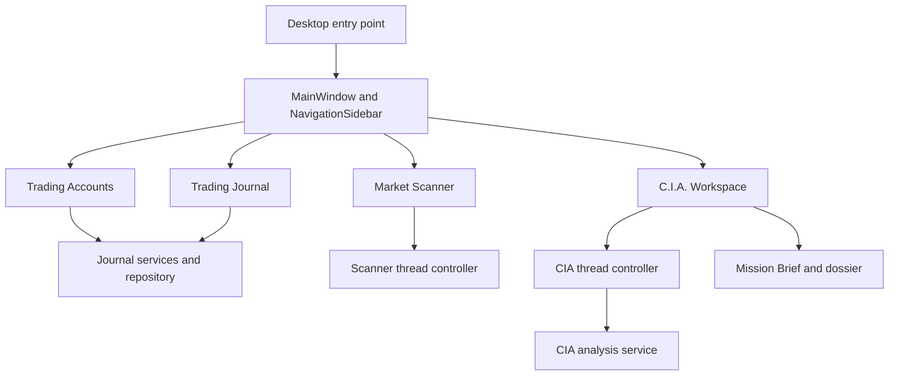

# STONKS Desktop GUI

[← Back to Main README](../README.md) · [Journal Subsystem](journal.md) · [C.I.A.](cia.md)

STONKS uses PySide6 for a desktop trading journal, market scanner, and catalyst-intelligence workspace. Its main window provides persistent sidebar navigation, a dark theme, and separate pages for each workflow. Financial calculations and database writes remain in the journal service layer.

## Navigation

| Page             | Current functionality                                                                                  |
| ---------------- | ------------------------------------------------------------------------------------------------------ |
| Trading Accounts | Account creation/editing, default selection, archive/reactivate, guarded deletion, and account details |
| Trading Journal  | Account-scoped positions, executions, filters, and performance metrics                                 |
| Market Scanner   | Standard Market Scanner, strategy selection, ANY/ALL matching, Run/Cancel, and results                 |
| C.I.A.           | Ticker analysis, Mission Brief, supporting articles, and article dossiers                              |
| Dashboard        | Placeholder                                                                                            |

### Trading Accounts and Account Details

1. Open **Trading Accounts** and create an account. Supported types include Cash, Roth IRA, Traditional IRA, Margin, and Other.
2. Choose a default account or manage an existing account with **Actions**.
3. Double-click an account to open **Account Details**.
4. Record a dated **Opening Cash** snapshot when a known cash balance is available. A snapshot is not a deposit.
5. Use **New Transaction** for deposits, withdrawals, fees, and adjustments; use **Transfer Funds** for linked transfers between tracked accounts.

Account Details shows ledger cash, net contributions, realized P&L, and equity at cost basis. These are accounting values, **not live broker balances or market valuations**. Archived accounts remain viewable but are not editable until reactivated.

### Trading Journal and Position Details

1. Open **Trading Journal** and select an account.
2. Add a position, with optional strategy and catalyst context.
3. Search by ticker or filter Draft, Open, and Closed positions.
4. Double-click a position to inspect its executions and performance.
5. Add BUY/SELL executions, or edit and delete existing executions using the available actions.

Position analytics include remaining shares, historical average buy price, cost basis, realized P&L, realized return, and lifecycle status. Partial entries and exits are supported.

### Market Scanner

The Scanner page runs the Standard Market Scanner in a background worker. It supports strategy selection, ANY/ALL matching, results display, status feedback, and cooperative cancellation. See [Scanner Workspace](scanner_workspace.md).

### C.I.A. Workspace

1. Open **Catalyst Intelligence Analysis** from the sidebar.
2. Enter a ticker and choose **Analyze Ticker**, or press Enter in the ticker field.
3. Review the **Mission Brief**: catalyst status, strength, freshness, sentiment, confidence, current and historical intelligence, and supporting-article counts.
4. In **Supporting Intelligence**, double-click an article or activate its selected row with Enter.
5. Read the **Article Dossier** and optionally choose **Open Original Article** to open its valid HTTP(S) publisher link.
6. Return to the briefing using **Back to Mission Brief**, Backspace, or Escape.

Returning from a dossier retains the briefing and article selection. A new successful analysis replaces the briefing and returns to the Mission Brief. If a request fails, the previous successful briefing remains available and request controls are restored.

CIA analysis runs in a `QThread` so the GUI remains responsive. Requests cannot overlap. A running provider request is not cancellable; application closure is deferred until the worker exits. See [C.I.A.](cia.md) for the analysis pipeline and provider limitations.

## GUI architecture

`gui/styles/theme.py` defines the shared dark stylesheet, and `gui/icons.py` provides reusable SVG icons. The GUI coordinates interaction and presentation while the journal and CIA services own their respective domain logic.
