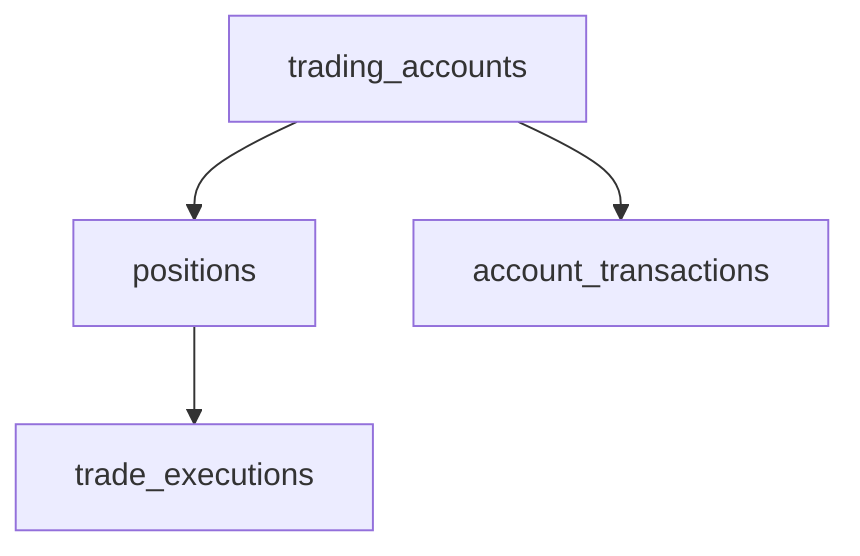

# Journal Subsystem

[← Back to Main README](../README.md)

The STONKS Journal provides persistent storage, validation, and financial analytics for trading activity across multiple brokerage accounts. Its SQLite backend supports a PySide6 desktop Trading Journal while keeping database operations, business rules, analytics, and presentation separate.

---

## Features

- SQLite persistence (schema v2) and account-owned financial records
- Multiple trading accounts, default selection, archival, and reactivation
- Position and BUY/SELL execution management, including partial entries and exits
- Account cash transactions, including deposits, withdrawals, fees, adjustments, and transfers (backend)
- Position, account, and consolidated portfolio analytics
- Validated repository/service operations and database integrity constraints
- SQLite backup and restoration, plus human-readable CSV exports
- Desktop Trading Journal with position analytics, ticker search, and status filters
- Automated backend and GUI regression tests

**GUI scope:** The desktop application currently provides Trading Accounts, Positions, and Execution Details workflows.

For screen-by-screen instructions and GUI architecture, see [Desktop GUI Guide](gui.md).

---

## Database Architecture

The Journal uses four primary SQLite tables.

| Table                  | Primary Key      | Purpose                          |
| ---------------------- | ---------------- | -------------------------------- |
| `trading_accounts`     | `account_id`     | Brokerage account information    |
| `positions`            | `position_id`    | Individual trading positions     |
| `trade_executions`     | `execution_id`   | BUY and SELL executions          |
| `account_transactions` | `transaction_id` | Non-trade account cash movements |

### Table Relationships



Every position belongs to one account. Each execution belongs to a position and inherits that position's account ownership. Account transactions belong directly to an account; their IDs are distinct from execution IDs.

### Storage

The configured database file is `data/journal/stonks_journal.db`, relative to the project root, as defined in `stonks/config/journal_paths.py`. Runtime journal data is excluded from version control.

SQLite STRICT tables, foreign keys, and database triggers protect data integrity. Tests use temporary databases rather than the local journal database.

---

## Trading Accounts

Supported account types are Roth IRA, Traditional IRA, Cash, Margin, and Other. Accounts hold a name, type, and optional broker information.

The first active account becomes the default. Default changes are atomic. Archived accounts retain historical records but cannot receive new activity or become the default; the current default must be reassigned before archival.

The desktop **Trading Accounts** page supports creating and editing accounts, choosing a default, archiving and reactivating accounts, and confirming permanent deletion when allowed by service safeguards. Archived records remain visible.

---

## Positions and Trade Executions

A position represents a trading opportunity for one ticker within one account. It can store a strategy, catalyst, entry and exit reasoning, mistakes, lessons learned, and notes.

A position may have multiple executions, allowing scaling in and out:

```text
Position #1 — NVDA

BUY    100 shares
BUY     50 shares
SELL    75 shares
SELL    75 shares
```

Each execution records its BUY/SELL side, timestamp, quantity, price, fees, and optional notes. Monetary values are calculated with `Decimal`, with exact-value text storage in SQLite where applicable.

### Desktop Workflow

On the **Trading Journal** page, choose a trading account and create a position using the plus button. Select a position to edit or delete it through the Actions menu. A position with execution history cannot be deleted from the overview.

Double-click a position to open **Position Details**. The dialog displays metadata, performance metrics, and chronological execution history. Use **Add Execution** or the execution Actions menu to create, edit, or delete fills. Service validation enforces execution chronology, prevents selling more shares than held, and protects archived accounts against modification.

The overview supports case-insensitive ticker search and **All / Draft / Open / Closed** status filtering. Search and status filters can be combined, and both remain in effect when switching accounts. Positions and executions are persisted through `JournalService`, not directly by GUI widgets.

---

## Account Transactions

Account transactions represent cash activity separately from trade executions. `AccountTransactionType` defines:

| Type           | Effect on account cash |
| -------------- | ---------------------- |
| `DEPOSIT`      | Increases cash         |
| `WITHDRAWAL`   | Decreases cash         |
| `FEE`          | Decreases cash         |
| `ADJUSTMENT`   | Signed cash adjustment |
| `TRANSFER_IN`  | Increases cash         |
| `TRANSFER_OUT` | Decreases cash         |

Each transaction records its account, category, time, amount, and optional notes. `JournalService` provides validated creation, updates, and deletion; `JournalRepository` persists and retrieves the records.

**Current GUI limitation:** There is no screen to enter or review these transactions yet. Likewise, the system does not provide a single atomic, linked two-account transfer operation: incoming and outgoing transfer entries are separate records. Avoid representing transfers as ordinary deposits and withdrawals when calculating external contributions.

Account-level analytics reconstruct cash balances from recorded activity and assume complete history with a zero opening balance. For existing accounts, an opening-balance/import approach needs to be established before relying on these totals as a complete historical picture.

---

## Account Ownership and Integrity

Schema v2 requires valid account ownership for positions and transactions. `JournalService` validates account existence and active status, rejects forbidden changes, and coordinates atomic writes. Database constraints enforce foreign keys, strict column typing, and immutable account ownership; triggers protect against bypassing the service through direct SQL.

The GUI also disables editing controls for archived accounts, but **service and database validation remain the authoritative safeguards**.

---

## Application Architecture

| Package       | Responsibility                                |
| ------------- | --------------------------------------------- |
| `models`      | Domain entities and enumerations              |
| `analytics`   | Position, account, and portfolio calculations |
| `persistence` | SQLite, repositories, and backups             |
| `services`    | Validated operations and transactions         |
| `validation`  | Financial and domain integrity rules          |
| `export`      | CSV record exports                            |

### Application Bootstrap

`JournalContext` initializes the SQLite database and connection, exposes `m_repository` and `m_service`, and closes the connection on exit.

The GUI entry point is `stonks.gui.app`. It creates `QApplication`, applies the dark stylesheet, constructs `MainWindow` with a shared `JournalContext`, and runs the Qt event loop. `MainWindow` uses a persistent navigation sidebar and stacked pages. Trading Accounts and Trading Journal are implemented; Dashboard, Scanner, and C.I.A. destinations are currently placeholders in the desktop shell.

To launch the desktop GUI from an activated project environment:

```powershell
python -m stonks.gui.app
```

`python -m stonks` still launches the scanner rather than the desktop GUI. See [Desktop GUI Guide](gui.md) for component details and interaction patterns.

### Repository, Service, and Analytics

`JournalRepository` handles data access. `JournalService` applies business rules and manages atomic operations. Analytics functions calculate financial values from domain records. The GUI invokes these layers rather than implementing financial calculations or direct SQL itself.

---

## Journal Analytics

### Position Analytics

The position engine calculates open shares, average entry price for remaining shares, **historical average buy price**, remaining cost basis, realized P&L, realized return percentage, lifecycle status (**Draft / Open / Closed**), and holding duration. It supports partial entries and exits.

The Trading Journal overview displays ticker, status, remaining shares, realized P&L, and realized return. Position Details adds metric cards, including historical average buy price and remaining cost basis.

Realized return is measured against the cost basis of shares sold; it is not an unrealized or live-market return.

### Account Analytics

Account analytics combine non-trade transactions with execution cash flows and position metrics to derive total deposits, withdrawals, net contributions, cash balance, realized trading P&L, account-level fees, net realized P&L, open position cost basis, and equity at cost basis.

These computations exist in the backend but are not yet presented as a dedicated account-performance screen in the desktop GUI.

### Portfolio Analytics

`analyze_portfolio()` consolidates financial metrics across trading accounts, optionally restricted to a selected subset. By default it includes archived accounts as well, avoiding duplicate account counting.

### Financial Consistency

- Net contributions = Deposits − Withdrawals
- Net realized P&L = Realized trading P&L − Account fees
- Equity at cost basis = Cash balance + Open position cost basis

### Current Limitations

Equity at cost basis is **not** live market equity. Unrealized P&L and current market valuations are not included. Transfers have distinct incoming/outgoing transaction types but are not linked as an atomic transfer. Historical equity curves and more advanced trading-pattern analysis remain future enhancements.

---

## Journal Backups

The Journal uses SQLite's native backup API to make consistent copies of the database, including accounts, positions, executions, transactions, indexes, and triggers.

Before restoration, the system checks that the file exists, passes SQLite integrity validation, contains the required tables, and matches the supported schema version. Restoration creates a safety backup of the current database and validates the result afterward.

These backup and restore capabilities exist in the backend; they are **not yet exposed as desktop GUI controls**.

---

## CSV Exports

The journal can export human-readable records into a timestamped directory:

```text
journal_YYYYMMDD_HHMMSS_ffffff/
├── trading_accounts.csv
├── positions.csv
├── trade_executions.csv
└── account_transactions.csv
```

CSV exports support inspection, outside analysis, and portability. **SQLite backups are the authoritative restoration format**, not CSV exports. Desktop export controls are not yet implemented.

---

## Testing

Pytest tests cover SQLite initialization and schema rules; account, position, execution, and transaction operations; analytics; financial integrity; backup/restore; and CSV export. GUI tests additionally exercise account and position management, execution dialogs, analytics display, ticker search, status filters, and selection safety. Temporary SQLite databases isolate automated tests from personal journal data.

From an activated development environment:

```powershell
.\scripts\lint.ps1
.\scripts\test.ps1
```

See [Desktop GUI Guide](gui.md) for further GUI-specific development information.
