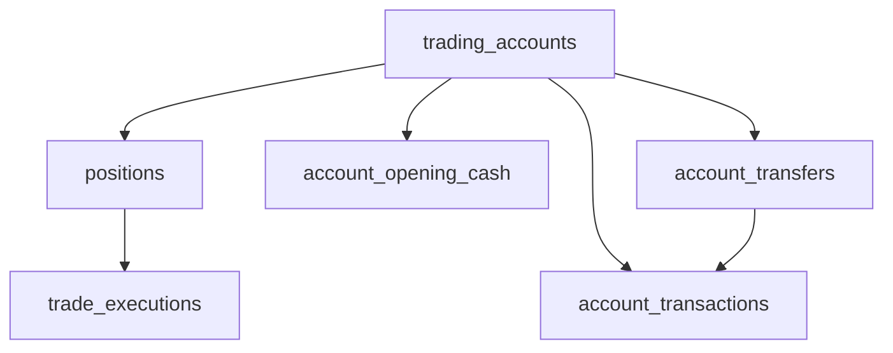

# STONKS Journal Subsystem

[← Back to Main README](../README.md) · [Desktop GUI Guide](gui.md)

The STONKS Journal records trading activity across brokerage accounts, with SQLite persistence, service-layer validation, and separate financial analytics. Introduces an interactive PySide6 journal, verified opening cash, and linked internal account transfers.

## Architecture

| Component            | Responsibility                                                             |
| -------------------- | -------------------------------------------------------------------------- |
| `models/`            | Accounts, positions, executions, transactions, transfers, and opening cash |
| `persistence/`       | SQLite schema, journal repositories, backup and restore                    |
| `services/`          | Validated changes and atomic transaction boundaries                        |
| `validation/`        | Account rules, position chronology, and cash-history safeguards            |
| `analytics/`         | Position, account, and portfolio metrics                                   |
| `export/`            | CSV export of database records                                             |
| `journal_context.py` | Owns the database connection, repository, and service lifecycle            |

The GUI reads through repositories and analytics and writes through `JournalService`; Qt widgets do not implement independent accounting rules.

## SQLite schema v3

| Table                  | Purpose                                                            |
| ---------------------- | ------------------------------------------------------------------ |
| `trading_accounts`     | Brokerage account metadata and active/default status               |
| `account_opening_cash` | One dated opening cash snapshot per account                        |
| `positions`            | Account-owned trading opportunities and reflection notes           |
| `trade_executions`     | BUY/SELL fills, shares, price, fees, timestamp, and notes          |
| `account_transactions` | Deposits, withdrawals, fees, adjustments, and linked transfer legs |
| `account_transfers`    | Parent record linking the source, destination, amount, and time    |



The parent transfer represents one operation with opposite cash flows in two accounts. Transfer creation, editing, and deletion occur atomically. Foreign keys, STRICT tables, and account-ownership triggers complement service validation. The database defaults to `data/journal/stonks_journal.db`; local databases and backups are runtime artifacts, not source files.

Initialization expects schema v3, and rejects incompatible older/provisional schemas rather than silently migrating them. Back up valuable data before changing or restoring a database.

## Accounts and financial history

Trading account types are Roth IRA, Traditional IRA, Cash, Margin, and Other. The first account becomes the default; eligible accounts can be edited, archived, reactivated, or permanently deleted through guarded actions. Archived accounts remain available for analysis but are read-only.

**Opening cash** is a dated snapshot of available account cash, not a contribution. Cash balance reconstruction begins at that snapshot and includes transactions and executions on or after its timestamp. Earlier ledger entries remain historical records but do not alter reconstructed cash. If no snapshot exists, analytics sum all recorded movements starting from an **unverified** zero assumption.

Independent ledger transactions include `DEPOSIT`, `WITHDRAWAL`, `FEE`, and signed `ADJUSTMENT`; paired `TRANSFER_IN` and `TRANSFER_OUT` records are created only by transfer operations. Internal transfers reallocate cash rather than creating external deposits, withdrawals, or trading gains.

Cash, Roth IRA, and Traditional IRA accounts with verified opening snapshots reject operations that would cause negative _recorded_ cash at any later ledger timestamp. Accounts with linked transfers receive additional cash-history protection. Margin accounts without transfers can record negative cash; this is not a margin buying-power or settlement model. Historical updates and deletions are checked against subsequent recorded events and rolled back when invalid.

## Positions and executions

Each position belongs to one account and can store ticker, strategy, catalyst, entry/exit reasoning, mistakes, lessons, and notes. Executions track BUY/SELL direction, aware timestamp, Decimal shares and price, and fees. Partial entries/exits are supported. Service validation prevents overselling, invalid execution chronology, and changes on archived accounts.

In the GUI, use **Trading Journal** to select an account, create a position, search by ticker, or filter Draft/Open/Closed positions. Double-click a position to open Position Details; add or manage its executions there. Double-clicking an execution opens its editor. A position with recorded executions cannot be removed through the empty-position deletion workflow.

## Financial analytics

Position analytics use **weighted-average cost** accounting and provide remaining shares, historical average buy price, average entry price for remaining shares, remaining cost basis, realized P&L, realized return, status, and holding duration.

Account analytics combine dated cash events with recorded executions and position metrics:

- **Net contributions:** deposits minus withdrawals (internal transfers excluded).
- **Cash balance:** opening snapshot plus eligible recorded cash flows; before-snapshot events are excluded from _cash only_.
- **Net realized P&L:** realized trading P&L minus standalone account fees.
- **Equity at cost basis:** recorded cash balance plus remaining position cost basis.

Contributions and realized-P&L metrics retain their all-record history even when a cash snapshot exists. `analyze_account()` and `analyze_portfolio()` use persisted opening snapshots, matching the opening-aware Account Details view. Portfolio aggregation covers all tracked accounts by default, including archived accounts, or an explicitly selected subset.

**Limitations:** these figures are journal/book values, not live brokerage balances, market-value equity, unsettled-funds availability, or unrealized P&L. This is not a brokerage order-execution or buying-power engine.

## Backup, restore, and CSV export

`journal_backup.py` uses SQLite's native backup API. Validation checks SQLite integrity, required tables, and schema version; restoration creates a safety backup of the current database first. Restore only when the application is closed, so an open GUI connection is not holding stale state.

`journal_export.py` writes a timestamped folder with these six CSV files:

```text
journal_YYYYMMDD_HHMMSS_ffffff/
├── account_opening_cash.csv
├── account_transactions.csv
├── account_transfers.csv
├── positions.csv
├── trade_executions.csv
└── trading_accounts.csv
```

CSV is useful for inspection and outside analysis. **SQLite backups, not CSV exports, are the supported restoration format.** Backup/restore and CSV export are backend utilities; they are not currently exposed as dedicated desktop controls.

## Operation

Launch the desktop UI from an activated development environment:

```powershell
python -m stonks.gui.app
```

The scanner remains separately available via `python -m stonks` or `scripts/run.ps1`.
